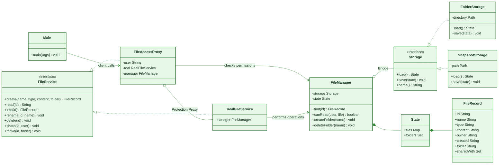

# Tima & Salta's File Storage — UML class diagram

The green palette distinguishes the two patterns: dark green for the file-management bridge, mint green for storage implementations, and lime green for the access proxy.

`FileManager` uses the `Storage` interface, so either persistent implementation can be selected without changing file-management code. `FileAccessProxy` checks the owner and sharing data in `FileRecord` before delegating to `RealFileService`.
